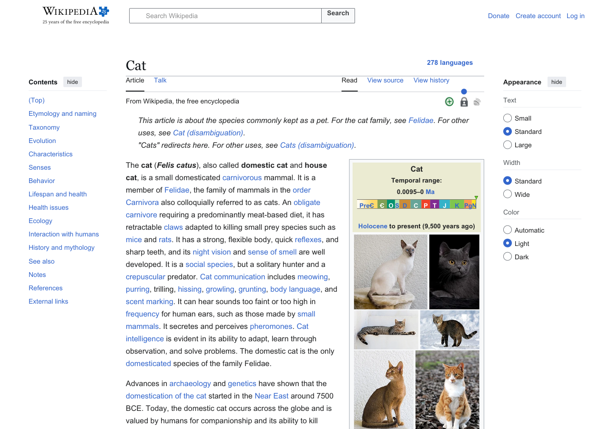
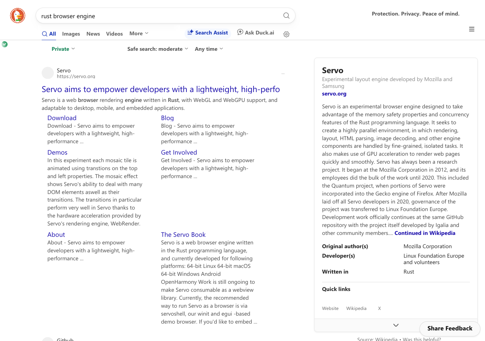
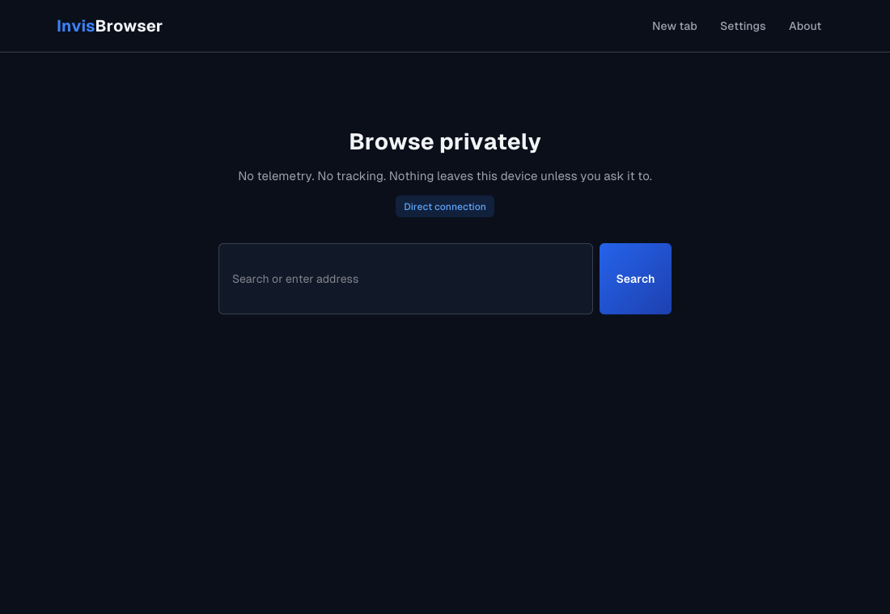

# Invisium

A web browser engine written from scratch in Rust, and **InvisBrowser**, a small privacy-first
browser built on it.

"From scratch" is the point of the project: the HTML parser, CSS parser and cascade, layout,
painting, the JavaScript engine, the regular-expression engine, the HTTP stack, URL and cookie
handling and the SVG rasteriser are all implemented in this repository. No code from Chromium,
WebKit, Gecko or Servo is used, and no crate that does the engine's own job. Third-party crates
are used only for platform plumbing: the GPU API (`wgpu`), TLS cryptography (`rustls`), image
codecs (`image`), glyph outlines (`ab_glyph`), windowing (`winit`) and the Tor protocol (`arti`).
That includes the graphics stack pages see: the 2D canvas is a software rasteriser written here,
and WebGL is a state machine plus a GLSL-to-WGSL shader translator written here, on top of `wgpu`.

This is work in progress. It is not a finished browser.

## Fair warning

- **No security assessment has been done.** Every part that reads untrusted input (the HTML,
  CSS and JavaScript engines, the image and font paths, the network stack) is new code that
  nobody has audited or fuzzed, and pages are not sandboxed: the browser is one ordinary
  process with your user account's rights. Do not use it for banking, accounts you care about
  or anything else where a malicious page could hurt you.
- **It is still fingerprintable, because it is custom.** The privacy features cut down on
  tracking by cookies, trackers and tracking parameters, and can hide your network address
  behind a proxy or Tor. They do not make you blend in. A from-scratch engine behaves unlike
  every mainstream browser (which script and CSS features exist, how pages are laid out, how
  it speaks TLS and HTTP), so a site that looks can tell this browser apart from all others,
  and very few people run it. With Tor turned on, your traffic goes through Tor, but you do
  not look like Tor Browser's other users: do not rely on it for anonymity.



## Status

| Area | State |
|---|---|
| Static sites (Wikipedia, Hacker News, documentation, blogs) | Render well |
| JavaScript | Own engine: ES2022-level language, promises/async, generators, Proxy, RegExp, `Date`, typed arrays, `BigInt`, ES modules, a fixed-locale `Intl`. Off by default in the browser ("JavaScript (experimental)" setting). |
| DOM | Events, selectors, forms, timers, `fetch`/XHR (CORS enforced in the network stack), custom elements, `URL`, storage (session only), `TextEncoder`, `crypto.getRandomValues`, `requestAnimationFrame`, `IntersectionObserver`, `ResizeObserver`, file inputs |
| Animation and graphics | CSS transitions and `@keyframes` animations, `Element.animate`, 2D transforms, `position: sticky`, smooth scrolling, web fonts (WOFF2/TrueType/OpenType, kept separate per page), inline SVG with gradients and dashed strokes |
| Canvas | 2D canvas (software rasteriser: paths, strokes, gradients, patterns, text, compositing, shadows); WebGL 1 and 2 (own GLSL ES 1.00/3.00 translator; three.js scenes run). Limits and identification strings are fixed values, not the machine's. Not yet: `` as a texture or canvas source, `toDataURL`, named uniform blocks, shadow samplers |
| Frames | `<iframe>` documents load, paint inside the page, take input, and talk to the embedding page with `postMessage`; each document has its own script engine, so there is no direct access between documents |
| Script-heavy sites | Wikipedia and Hacker News run their scripts cleanly; DuckDuckGo's results page and YouTube's signed-out home page render; many others still fail |
| Privacy | Tracker blocking, HTTPS-only mode, tracking-parameter stripping, partitioned in-memory cookies and cache, DNS-over-HTTPS, HTTP/SOCKS5 proxies, embedded Tor (optional feature), fixed generic user agent, `Intl`/`Date` always report `en-US`/UTC, public pages cannot reach local-network addresses |
| Not there yet | Video and audio, downloads, WebSocket for pages (the network stack has a client; it is not wired to scripts yet), text selection, find-in-page, bookmarks/history, HTTP/2, shadow DOM (pages that ship a polyfill work), incremental layout |

| | |
|---|---|
|  |  |
| DuckDuckGo's results page (scripts on) | YouTube's signed-out home page (scripts on) |
|  | |
| The browser's own new-tab page | |

## Building

Requires stable Rust (1.92 or newer). Developed on Windows 10/11 with the MSVC toolchain; other
platforms are a goal, not yet a tested target.

```sh
cargo test --workspace                 # all tests
cargo run -p invisbrowser              # the browser window
cargo run -p invisbrowser -- https://en.wikipedia.org/wiki/Cat
cargo run --release -p invisbrowser --features tor     # with the embedded Tor client
```

Render a page without a window:

```sh
cargo run -p invisbrowser -- --screenshot <address> out.png --width 1280 --height 900 --dump
cargo run -p invisbrowser -- --screenshot <address> out.png --js --console
```

`--dump` prints page statistics (nodes, boxes, memory, network), `--js` runs the page's scripts,
`--console` prints what they log, `--eval "<javascript>"` runs one more script after load,
`--scroll Y` looks further down the page (`--after MS` lets animations run that long first).

## Layout of the workspace

| Crate | What it is |
|---|---|
| `crates/invisium` | Engine core: HTML parser, CSS parser and cascade, fonts, layout (block, inline, flex, grid, table), paint, the `Page` type, and the DOM bindings for scripts |
| `crates/invisium-js` | JavaScript engine: lexer, parser, bytecode compiler, VM, garbage collector, built-ins, embedding API |
| `crates/invisium-regex` | ECMAScript regular-expression engine (backtracking, UTF-16) |
| `crates/invisium-net` | URL, HTTP/1.1, TLS, privacy policy pipeline, cookies, cache, DNS-over-HTTPS, proxies, Tor, CORS, framing rules, WebSocket client, downloads to a file |
| `crates/invisium-gfx` | GPU renderer (wgpu), glyph atlas, image decoding, SVG rasteriser, and the GPU side of WebGL |
| `crates/invisium-glsl` | Shader translator: GLSL ES 1.00 / 3.00 to WGSL, with the reflection data WebGL reports |
| `crates/invisium-gl` | WebGL 1 / 2 state machine on the CPU: objects, validation, errors, pixel conversion; emits GPU commands |
| `crates/invisium-canvas` | 2D canvas: `CanvasRenderingContext2D` state machine and software rasteriser |
| `crates/invisium-draw` | Display-list types shared by the painter, the renderer and the browser UI, and the WebGL command contract |
| `crates/invis-chrome` | Browser UI kit: tabs, toolbar, address bar, privacy panel, internal pages |
| `crates/invisbrowser` | The application: window, tabs, navigation, settings, screenshot mode |

## License

MIT. See [LICENSE](LICENSE). The bundled Geist fonts are under the SIL Open Font License.
